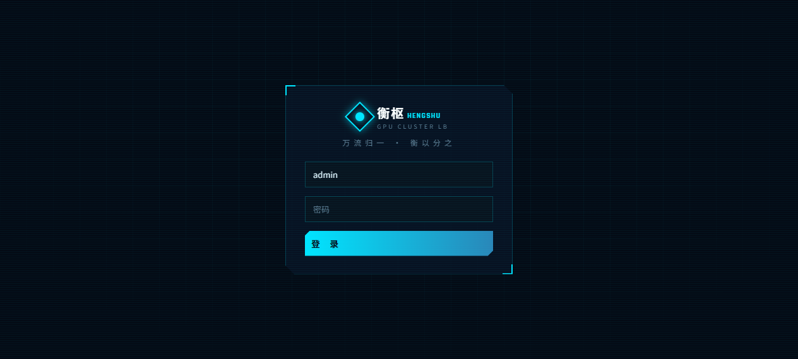
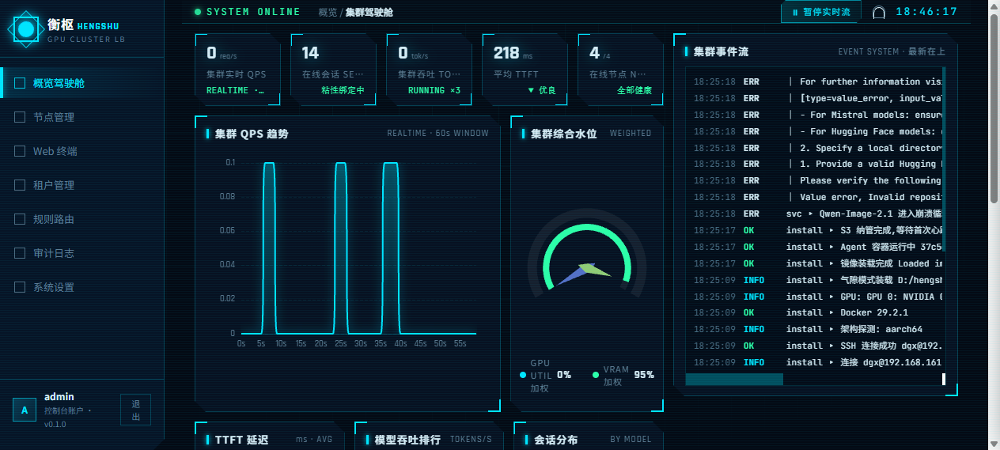
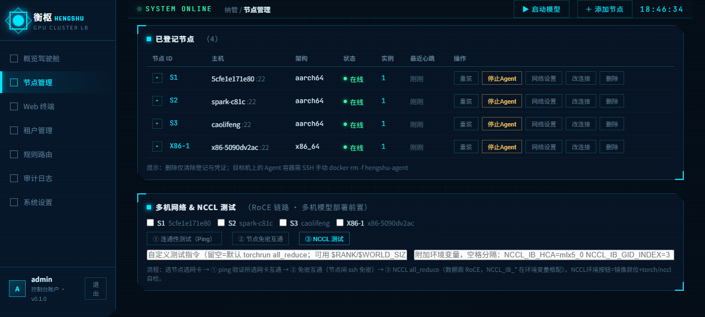
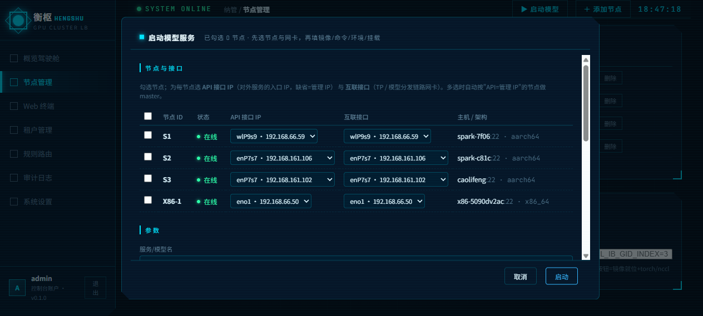
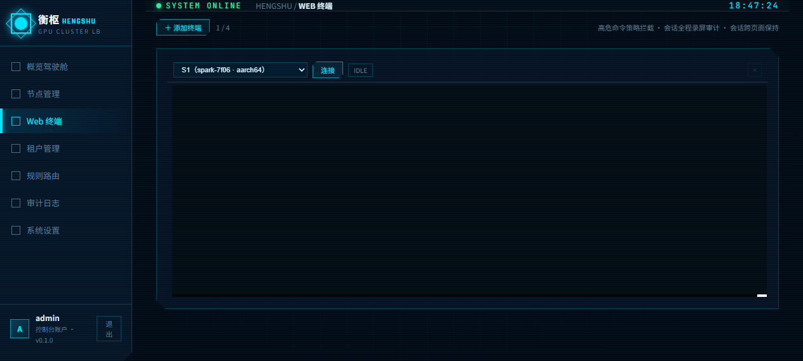
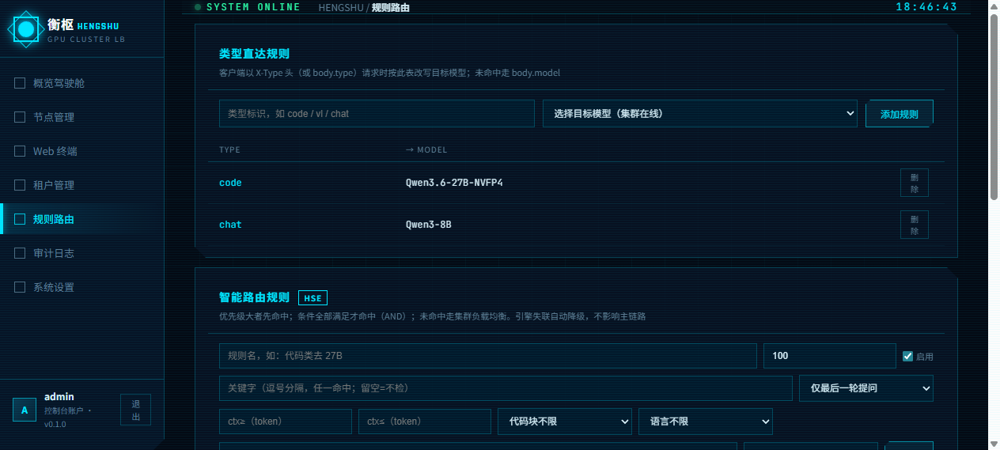
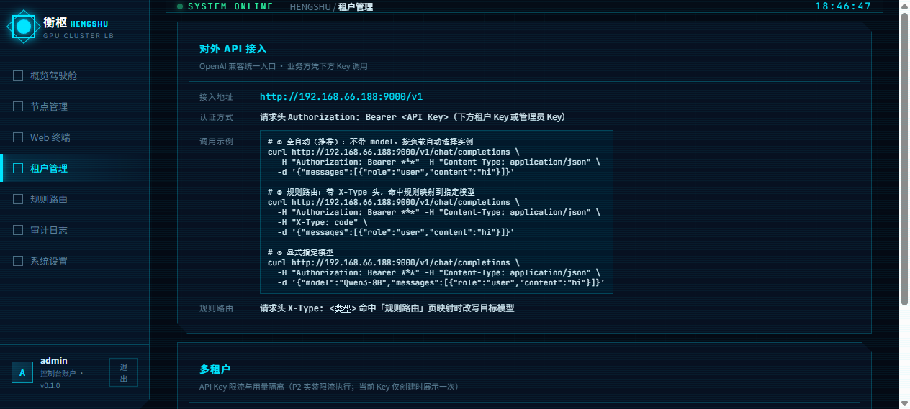
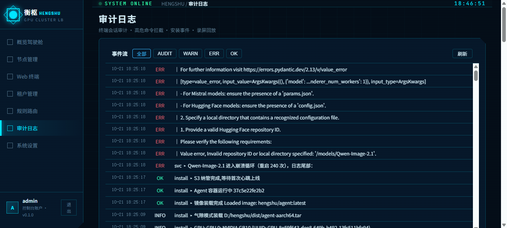
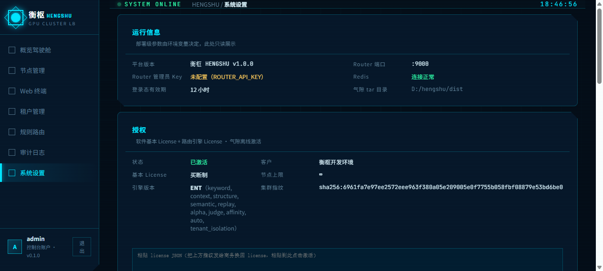

# 衡枢 HENGSHU 用户指南

> **文档版本 v1.0 ｜ 对应平台版本 v1.0.0**
> 版本同步规则：平台每次迭代更新（git tag），本文档同步更新并重标版本号；文内截图与所述功能以同版本平台为准。

衡枢 HENGSHU 是多机推理 API 负载均衡平台：**一个统一 OpenAI 兼容入口**（`VIP:9000`），把多张显卡/多台推理机（x86 + NVIDIA PCIe 卡、Jetson、DGX Spark 等 ARM64）纳管成一个集群，提供智能路由、模型分发、监控仪表盘、Web 终端、多租户与气隙离线交付能力。

**Slogan：万流归一，衡以分之。**

---

## 目录

1. [平台架构与组件](#1-平台架构与组件)
2. [快速开始](#2-快速开始)
3. [登录](#3-登录)
4. [驾驶舱（概览）](#4-驾驶舱概览)
5. [节点管理](#5-节点管理)
6. [模型服务（启动/分发/巡检）](#6-模型服务)
7. [Web 终端](#7-web-终端)
8. [统一 API 入口（Router）](#8-统一-api-入口router)
9. [HSE 智能路由引擎](#9-hse-智能路由引擎)
10. [多租户](#10-多租户)
11. [授权体系（License）](#11-授权体系license)
12. [语义引擎部署（Ollama）](#12-语义引擎部署ollama)
13. [审计](#13-审计)
14. [系统设置](#14-系统设置)
15. [运维与排障](#15-运维与排障)
16. [版本与更新](#16-版本与更新)

---

## 1. 平台架构与组件

```
                ┌────────────────────────────────────────────┐
   客户端 ────► │ Router  :9000（统一入口，OpenAI 兼容）      │
                │   ├─ /v1/chat/completions（对话）           │
                │   ├─ /v1/images/generations（图像）         │
                │   ├─ 会话保持 / 失败迁移 / 重试             │
                │   └─ 调用 HSE 决策（失联自动降级负载均衡）   │
                ├────────────────────────────────────────────┤
                │ HSE 路由引擎 :9100（授权能力位驱动）         │
                │   信号层→投影→决策（规则/语义/裁判/亲和）    │
                ├────────────────────────────────────────────┤
                │ Console 控制台 :8080（本指南的主体）         │
                │   管理面 UI + REST API + Web 终端 + 审计     │
                ├────────────────────────────────────────────┤
                │ Redis（注册表/规则/租户/事件流/计量）        │
                └────────────────────────────────────────────┘
                          │ SSH 纳管 / Agent 心跳
        ┌─────────────────┼──────────────────┐
        ▼                 ▼                  ▼
   ┌─────────┐      ┌─────────┐        ┌─────────┐
   │ X86 节点 │      │ Spark   │        │ Jetson  │  …
   │ L4/5090 │      │ GB10    │        │ Orin    │
   │ Agent:9100     │ Agent   │        │ Agent   │
   └─────────┘      └─────────┘        └─────────┘
```

| 组件 | 默认端口 | 职责 | 交付形态 |
|---|---|---|---|
| Console | 8080 | 管理控制台（本 UI）+ 纳管/分发/审计 | docker tar（amd64/arm64） |
| Router | 9000 | 统一 API 入口、负载均衡、会话保持 | docker tar |
| HSE | 9100 | 智能路由引擎（授权分级 STD/PRO/ENT） | docker tar |
| Agent | 9100（节点侧） | 节点心跳、服务启停、指标采集、终端 | docker tar（随节点架构） |
| Redis | 6379 | 状态中枢 | 复用现有或随包 |

**重点**：Console 无状态，可部署到任意节点（包括被纳管的推理机本机）；所有状态在 Redis。

---

## 2. 快速开始

**目标：10 分钟跑通「纳管一台推理机 → 起一个模型 → 统一入口发问」。**

### 2.1 启动平台三件套

```bash
# Redis（任一可达地址，生产建议独立部署）
docker run -d --name hengshu-redis -p 6379:6379 redis:7

# Console（管理面）
docker load < console-x86_64.tar        # arm64 机器用 aarch64 包
docker run -d --name hengshu-console -p 8080:8080 \
  -e REDIS_URL=redis://<redis地址>:6379/0 \
  -e REDIS_ADVERTISE=redis://<控制台对外IP>:6379/0 \
  -e ADMIN_PASSWORD_HASH=$(python3 -c "import bcrypt;print(bcrypt.hashpw(b'你的密码',bcrypt.gensalt()).decode())") \
  -e INSTALL_TAR_DIR=/dist -v ./dist:/dist \
  hengshu/console:latest

# Router（流量面）
docker load < router-x86_64.tar
docker run -d --name hengshu-router -p 9000:9000 \
  -e REDIS_URL=redis://<redis地址>:6379/0 \
  -e HSE_URL=http://<hse地址>:9100 \
  hengshu/router:latest

# HSE 引擎
docker load < hse-x86_64.tar
docker run -d --name hengshu-hse -p 9100:9100 \
  -e REDIS_URL=redis://<redis地址>:6379/0 \
  hengshu/hse:latest
```

### 2.2 纳管第一个节点

1. 浏览器打开 `http://<控制台IP>:8080`，登录（默认 admin）
2. 「节点管理」→「添加节点」：填 SSH 地址/端口/用户/密码或私钥 → 平台自动推送安装 Agent（气隙环境预置 `INSTALL_TAR_DIR` 的 agent tar）
3. 节点上线（卡片显示 online、GPU 型号、显存）

### 2.3 起第一个模型

「节点管理」→「启动模型」对话框：
- 勾选目标节点
- 服务/模型名：`Qwen3-8B`
- 启动命令：`vllm serve /models/Qwen3-8B --port {port} --served-model-name Qwen3-8B`
- 服务端口：`8100`
- 卷挂载：`/home/user/models:/models:ro`（宿主机模型目录）
- 点「启动」→ 模型本地缺失时**自动从内网他机拷贝或在线拉取**（事件流可见进度）

### 2.4 发第一个请求

```bash
curl http://<控制台IP>:9000/v1/chat/completions \
  -H "Authorization: Bearer <管理员Key或租户Key>" \
  -H "Content-Type: application/json" \
  -d '{"model":"auto","messages":[{"role":"user","content":"你好"}]}'
```

响应中的 `instance` 字段告诉你请求实际落在哪个节点。

---

## 3. 登录



- 默认管理员 `admin`，密码由部署时 `ADMIN_PASSWORD_HASH` 环境变量设定
- 登录态有效期默认 12 小时（`TOKEN_TTL`）
- 角色三档：**viewer**（只读）/ **operator**（运维：节点/服务/规则/租户写操作）/ **admin**（全部 + 用户管理 + 授权）

**重点**：连续输错密码有审计记录（审计页可见）；忘记密码只能由部署者重设 `ADMIN_PASSWORD_HASH` 重启 Console。

---

## 4. 驾驶舱（概览）



进入即见的集群总览，数据每 4 秒自动刷新（系统设置可改间隔）。

**KPI 行（五卡）**：
| 卡片 | 含义 |
|---|---|
| 集群实时 QPS | Router 当前每秒请求数 |
| 在线会话 | 粘性会话绑定数（会话保持中） |
| 集群吞吐 | 全集群 tokens/s 合计 + 运行中服务数 |
| 平均 TTFT | 首 token 延迟均值（<500ms 为优良） |
| 在线节点 | online/总数，离线时红色告警 |

**图区**：
- QPS 趋势曲线（实时）
- 集群水位（GPU 利用率/显存占比仪表盘）
- 各模型吞吐分布、TTFT 分布
- 节点健康矩阵

**事件流（右侧/下方）**：集群发生的一切——节点上下线、服务启停、模型分发进度、崩溃告警、授权事件。级别：INFO / OK / WARN / ERR。

**授权异常横幅**：License 未激活/异常/宽限期时出现在 KPI 行下方（不挡数据）。点按指引到「系统设置 → 授权」处理。

**重点操作**：
- 右上角「⏸ 暂停实时流」可冻结刷新（查历史数字时用）
- 铃铛图标查看未确认告警

---

## 5. 节点管理



每节点一卡：状态（online/offline）、主机名、IP、架构（x86_64/aarch64）、GPU 型号、显存/温度/功耗实时值、已跑服务列表。

### 5.1 纳管新节点

「添加节点」：填 SSH 主机/端口/用户名 + 密码**或**私钥（PEM 全文粘贴）。平台自动：
1. 探测架构（amd64/arm64）选对应 agent tar
2. SFTP 推送 → docker load → 起 Agent 容器
3. TOFU 指纹登记（首次信任，变更会告警）
4. 心跳上线

**气隙环境**：把 `dist/agent-x86_64.tar` / `agent-aarch64.tar` 放到 Console 的 `INSTALL_TAR_DIR`，安装走离线装载，无需外网。

**重点**：SSH 凭证加密存储（AES-GCM，主密钥来自 `MASTER_KEY` 环境变量），仅用于安装/重装；日常心跳走 Agent HTTP。

### 5.2 改连接 / 重装

节点卡片「改连接」：更新 SSH 地址或凭证（重装 Agent 时用）。「重装」会推送当前 `INSTALL_TAR_DIR` 里的 tar 升级 Agent——**平台升级后务必对所有节点执行一次重装**，让新能力（如服务类型上报）生效。

### 5.3 网络设置与网卡

展开节点卡片可见网卡清单（含 down/无 IP/虚拟接口标记）。多机并行（TP）部署时需为每台节点选择**同二层链路的互联网卡**（NCCL/Ray 走该网段）。

### 5.4 删除节点

删除即解除纳管（Agent 停止移除）；节点上的服务容器一并停止登记。**墓碑机制**：刚删除的节点短暂留痕，防止幽灵 Agent 重新注册。

---

## 6. 模型服务



「节点管理」→「启动模型」对话框是部署入口（对话框高度自适应，内容超出时内部滚动）。

### 6.1 启动参数逐项

| 字段 | 说明 | 示例 |
|---|---|---|
| 节点勾选 | 单选=单节点；勾 ≥2 台=多机 TP 并行 | S2 + S3 |
| 服务/模型名 | 服务标识，也是路由模型名 | `Qwen3-8B` |
| 镜像 | 推理容器镜像（可换镜像站前缀） | `docker.1ms.run/vllm/vllm-openai:latest` |
| 启动命令 | 容器内执行；`{port}` 占位符自动替换 | `vllm serve /models/Qwen3-8B --port {port} --served-model-name Qwen3-8B` |
| 服务端口 | 容器监听端口 | `8100` |
| **服务类型** | **chat / embedding / image / custom**（见 6.3） | chat |
| 路由档位 | 仅 chat 类型可选：fast/medium/strong（HSE 档位路由用） | strong |
| 健康探测路径 | 仅 custom 类型显示 | `/system_stats` |
| 环境变量 | 每行 `KEY=VALUE` | `HF_HUB_OFFLINE=1` |
| 卷挂载 | 每行 `宿主路径:容器路径[:ro]`，**模型权重必配** | `/home/user/models:/models:ro` |

### 6.2 模型自动分发

启动命令里出现 `/models/<目录名>` 时，平台自动：
1. **本机已有且完整**（含 `config.json`/`params.json`/`model_index.json` 或权重文件）→ 直接启动
2. **他机有** → 内网 tar 流拷贝（控制台中转，事件流显示进度）；先落 `<模型>.hs-part` 临时目录，成功后才转正，**半成品永远不会被当成已有模型**
3. **全网无** → 节点在线拉取（ModelScope/HF 镜像，大模型需数十分钟）
4. **目录在但不完整** → WARN 事件明示并重新拉取补齐

**重点**：vllm 只支持 LLM/embedding 模型；图像/多模态生成模型请用对应框架（见 6.3 服务类型）。

### 6.3 服务类型（kind）

| 类型 | 路由行为 | 适用 |
|---|---|---|
| **LLM 对话**（默认） | 进对话路由池，`/v1/chat/completions` | Qwen/Llama 等生成模型（vllm/llama.cpp） |
| **Embedding** | 进路由池，`/v1/embeddings` | bge-m3 等向量模型 |
| **图像生成** | 独立图像池，`/v1/images/generations` | Qwen-Image/SD（ComfyUI、sd-forge 等 OpenAI 图像兼容框架） |
| **自定义框架** | **不进路由池**，仅纳管监控/启停/日志 | 任意自研 serving；流量直连节点端口 |

### 6.4 多机 TP 并行

勾选 ≥2 台节点时出现网卡选择（每节点选互联网卡）：
- 首节点为 master（API 入口所在），平台自动起 Ray head/worker 集群
- 集齐后 master 起 `vllm --tensor-parallel-size=N`
- 事件流全程可见：模型分发 → NCCL 链路 → Ray 组网 → vllm 加载

### 6.5 服务巡检与崩溃循环

Agent 每 5 秒巡检：
- 状态三态：`running` / `stopped` / `crashing`（重启 ≥3 次判崩溃循环）
- 转为 crashing 时**自动抓容器日志尾部打进节点系统日志**（事件流可见）
- 启动后 15s/2min 两次巡检，没活即报日志

### 6.6 服务操作

节点卡片服务行：停止 / 重启（沿用持久化 spec）/ 删除（保留 spec 作为下次启动模板）/ 查看日志。

---

## 7. Web 终端



浏览器内直连节点 Shell（SSH over WebSocket），仅 **admin** 可用。

- **多终端**：默认 1 个；「+」添加，2 个并排、3 个品字形、最多 4 个同屏同时连接
- **会话保持**：除非主动点「断开」，浏览其他页面连接不断（回来即恢复原会话）
- **命令审计与管控**：全命令落审计；黑白名单机制——`reboot`/`rm -rf /` 等高危命令直接拦截（事件流 WARN）
- **录屏**：asciinema 格式全程录制，审计页可下载回放（.cast）
- **连接自愈**：字体加载竞态自动处理，异常时「诊断」按钮一键上报渲染状态到服务端事件流

---

## 8. 统一 API 入口（Router）

所有流量走 `http://<平台IP>:9000`，OpenAI 兼容。

### 8.1 端点一览

| 端点 | 说明 |
|---|---|
| `POST /v1/chat/completions` | 对话（流式/非流式） |
| `GET /v1/models` | 在线模型清单 |
| `POST /v1/images/generations` | 图像生成（直通 image 类型服务） |
| `GET /healthz` | 存活探针（含版本号） |

### 8.2 认证

`Authorization: Bearer <key>`：
- **管理员 Key**：部署时 `ROUTER_API_KEY` 环境变量（无限额）
- **租户 Key**：多租户页签发（`hs-tnt-...`，QPS 限流 + 用量计量 + 模型白名单）

### 8.3 模型选择模式

```jsonc
{"model": "auto"}            // 全自动：HSE 规则/智能路由决策，未命中按负载挑
{"model": "Qwen3-8B"}        // 指定模型（该模型多实例间负载均衡）
```

### 8.4 会话保持（粘性）

- 请求头 `X-Session-Id: <id>` 或 body `session_id`：同会话请求**绑定到同一实例**（上下文 KV 连续）
- 实例宕机自动迁移：历史消息自动重放给新实例，客户端无感
- 响应带 `session_id`（新建时）与 `instance`（落点）

### 8.5 规则路由（类型直达）

请求头 `X-Type: code` 或 body `"type": "code"` 命中「路由规则」页的类型映射表，直接改写目标模型（优先级高于 HSE）。

### 8.6 失败重试与超时

- 上游连接失败/裸网络异常：自动换实例重试（最多 3 次），事件流 WARN 记录迁移
- 上游超时默认 1800s（长推理任务友好）
- 全程流式计量：token 用量按租户累计

**示例**（流式）：
```bash
curl -N http://<平台IP>:9000/v1/chat/completions \
  -H "Authorization: Bearer hs-tnt-xxx" \
  -H "X-Session-Id: demo-001" \
  -d '{"model":"auto","stream":true,"messages":[{"role":"user","content":"写个快排"}]}'
```

---

## 9. HSE 智能路由引擎



HSE（HengShu Engine）是独立进程（:9100）的可插拔智能路由引擎，Router 内部调用 `/v1/route-decision` 取决策；**引擎失联自动降级回普通负载均衡（fail-open），流量永不因引擎故障中断**。

### 9.1 规则结构

每条规则 = **条件（when）+ 动作（action）+ 优先级 + 开关 + 影子**：

- **动作**：目标模型（下拉选在线模型）或**档位别名**（fast/medium/strong——按启动服务时打的档标签路由，档内负载均衡；档位无在线实例自动回退全池）
- **优先级**：数字大者先匹配；同优先级比置信度，再同比**成本权重**（小者优先——「模型参数」区设置）
- **影子模式**（👻）：命中只记录不执行——新规则先挂影子观察一周再启用（审计页回放可见）

### 9.2 条件信号（按授权版本可用性）

| 条件 | 版本 | 说明 |
|---|---|---|
| 关键字 | STD | 逗号分隔；可选作用域（最后一条用户消息/全部消息/系统提示） |
| 上下文长度 | STD | ctx_min/ctx_max（token 数区间） |
| 结构特征 | STD | 含代码块 / 语言（中文/英文） |
| **语义例句** | PRO | 每行一条例句（3-5 条最佳）；提问与例句语义相近（bge-m3 向量 + 稀疏重合混合打分）超过阈值即命中；阈值留空走 模型阈值→默认 0.62 |
| **裁判** | ENT | 小 LLM 对请求做 YES/NO 终裁（裁判问题可自定义）；裁判答 YES 才命中 |

**α 激进度**（系统设置，PRO）：全局滑块，越高语义路由阈值越宽松（±0.1 偏移）。

### 9.3 模型参数（成本×阈值双旋钮）

规则页底部：每个在线模型的**成本权重**（同优先级命中时成本小者优先——省钱场景把贵模型调高）与**置信度阈值**（语义路由该模型的默认门槛）。

### 9.4 决策回放与统计

- **审计页「路由决策回放」**：最近 500 条决策——提问/命中规则/目标/置信度/信号/耗时，影子命中斜体区分
- **规则页统计行**：总决策数/命中率/影子命中/每规则均置信度与均耗时（影子转正前先看这里的真实表现）

### 9.5 前缀亲和（ENT）

相同前缀（首消息前 64 字符指纹）的请求优先回到**上次同一实例**——KV cache 复用降低 TTFT，30 分钟滚动 TTL，实例离线自动失效。

### 9.6 授权降级行为

引擎 License 到期/降级时：PRO/ENT 条件（语义/裁判）自动跳过（规则列表标灰提示），STD 条件继续工作；**所有跳过分段在决策里明示**，绝不静默漏配。

**示例——三层路由策略**：
```
规则1（priority 300, ENT）：裁判「是否需要深度推理？」→ strong 档（27B）
规则2（priority 200, PRO）：语义例句「写代码/调报错/解释函数」阈值0.6 → Qwen3-Coder
规则3（priority 100, STD）：关键字「翻译/translate」→ fast 档（8B）
其余 → 默认负载均衡池
```

---

## 10. 多租户



**创建租户**：标识（小写字母/数字/-_）+ QPS 上限 + **模型白名单**（ENT，逗号分隔，空=不限）→ 签发 API Key（`hs-tnt-...`）。

> ⚠ **API Key 仅在创建时展示一次**，请立即保存；丢失只能删除重建。

**能力**：
- **QPS 限流**：滑动窗口（1s），超限 429
- **模型白名单**（ENT `tenant_isolation`）：该租户请求白名单外模型 → 403 并提示可用清单；`auto` 模式自动收敛到白名单内模型。行内「编辑」可随时调整
- **用量计量**：prompt/completion tokens 按租户累计（表内 TOKENS 列），供计费/导出
- **删除租户**：Key 立即失效（反查索引同步清除）

**示例**：给「售前演示」租户只开放 8B 快模型：
```
租户: demo-sales, QPS 5, 白名单: Qwen3-8B
```

---

## 11. 授权体系（License）

两层授权，Ed25519 签名 + 集群指纹绑定，**气隙离线激活**（无需联网）。

### 11.1 两层结构

| 层 | 内容 | 形式 |
|---|---|---|
| **软件基本 License** | 平台全部基础能力（纳管/监控/终端/租户/规则路由/分发）+ HSE-STD | 订阅年费 **或** 买断（永久当前大版本，跨版本升级购维护包） |
| **路由引擎 License** | HSE 能力包（STD/PRO/ENT） | 前提 = 基本 License 有效 |

### 11.2 版本能力位

| 能力位 | STD | PRO | ENT |
|---|---|---|---|
| 关键字/上下文/结构信号、优先级、成本决胜、档位、fail-open | ✓ | ✓ | ✓ |
| 语义例句路由、决策回放、α 激进度 | | ✓ | ✓ |
| 裁判、前缀亲和、自学习统计、租户隔离 | | | ✓ |

### 11.3 到期语义（生产友好）

- **引擎包到期** → 只降级到 STD（基础信号继续）
- **基本 License 到期** → 30 天宽限期（黄色横幅提醒）→ 超期后**管理面只读**（红横幅），**流量面永不主动掐断**——跑着的推理服务不受影响
- **买断制** → 不过期；版本范围（version_cap）约束可运行的大版本

### 11.4 激活流程

1. 「系统设置 → 授权」复制**集群指纹**，发给商务
2. 商务用签发工具（`hs-license-tool-gui.exe`）签回 license JSON
3. 粘贴到授权区 → 激活。状态区显示客户/模式/到期/节点上限/引擎版本与能力位
4. 「移除授权」回到未激活态（管理面只读）

### 11.5 节点上限

License 的 `max_nodes` 限制纳管节点数（0=不限）；超限时纳管/重装被 403 拒绝并提示扩容。

---

## 12. 语义引擎部署（Ollama）

语义例句路由（PRO）需要一个 embedding 服务。「系统设置 → 语义引擎」一键搞定：

1. **部署到**：本机（控制台所在机）或任一在线节点（下拉列出）
2. **API 端口**（默认 11434）、**模型名**（默认 bge-m3）、**模型存放位置**（留空=Ollama 默认目录）
3. 节点部署需临时填 SSH 凭证（**仅本次使用，不落库**）
4. 「部署并接入」→ 平台自动：检测 Ollama（无则安装）→ 拉取模型（数 GB，分钟级，事件流看进度）→ 健康检查 → 写入引擎配置（5 秒热更）

状态行显示 `● 已接入 http://...`（绿）即语义路由可用。

**已有可用端点**（客户自建的 OpenAI 兼容 embedding 服务）→ 直接填 URL 点「接入」。

**α 激进度**滑块同页调整（保存即热更）。

---

## 13. 审计



三个区：
- **集群事件流**：全平台事件（级别过滤：全部/AUDIT/WARN/ERR/OK），写操作审计（谁/何时/做了什么）
- **路由决策回放**（PRO）：HSE 最近 500 条决策全记录——影子规则效果评估的第一手数据
- **终端录屏**：Web 终端 asciinema 录屏文件列表与下载（.cast，可用 `asciinema play` 回放）

---

## 14. 系统设置



| 区块 | 内容 |
|---|---|
| 运行信息 | 平台版本（衡枢 v1.0.0）、Router 端口、Redis 连通、登录态时长、气隙 tar 目录（只读） |
| **授权** | 集群指纹复制、license 粘贴激活/移除（见 §11） |
| **语义引擎** | Ollama 部署向导 + α 激进度 + 裁判端点（ENT）（见 §12；STD 时锁定提示） |
| Webhook 通知 | 节点安装结果/高危拦截 POST 到指定 URL（可发测试事件） |
| 修改管理员密码 | 立即生效（Redis 覆盖环境变量哈希），改后重新登录 |
| 用户管理（admin） | 建用户/改角色/禁用/删除；viewer 只读、operator 运维、admin 全部 |
| 显示偏好 | 驾驶舱刷新间隔（2/4/10/30s，存本浏览器） |

---

## 15. 运维与排障

| 现象 | 排查 |
|---|---|
| 页面白屏 | Ctrl+Shift+R 强刷（版本更新后旧 chunk 404 会自动整页刷新）；仍白屏看页面顶部红色错误条内容 |
| 服务启动后 crashing | 事件流已抓日志尾部；常见于模型目录不完整（平台会 WARN 并自动补齐重拉）或显存不足 |
| 模型没自动拉取 | 确认启动命令含 `/models/<目录名>`；节点 Agent 是否新版（重装更新）；事件流找 `model ▸` 行 |
| 语义规则不命中 | 系统设置确认语义引擎「已接入」绿点；License 须 PRO+；阈值是否过高（先看影子模式回放得分） |
| 裁判全跳过 | ENT License + 裁判端点配置；裁判模型建议非推理型小模型（Qwen3-1.7B 级） |
| 多机 TP 失败 | 网卡须同二层链路；事件流看 Ray/NCCL 阶段日志；模型是否两台都分发完成 |
| 401 invalid api key | Key 错或租户已删；管理员 Key 看 `ROUTER_API_KEY` |
| 429 QPS limit | 租户限流命中——升配额或降并发 |

**日志位置**：Console/Router/HSE 容器 `docker logs <name>`；节点侧 Agent `docker logs hengshu-agent`；服务日志在节点卡片行内「日志」。

---

## 16. 版本与更新

- **平台版本**：`v1.0.0`（`pyproject.toml` 单一事实源；`/api/healthz`、系统设置页可见；git tag 同号）
- **本文档版本**：v1.0，与平台版本对应
- **更新纪律**：平台功能迭代 → 升版本号（git tag）→ 本文档同步修订并重标版本；截图随 UI 变更重截
- **升级动作**（平台侧）：组件 tar 重打（`scripts/build-all-tars.sh`）→ docker load 替换 → **所有节点「重装」一遍 Agent**（新能力靠心跳上报生效）

### 变更记录

| 文档版本 | 平台版本 | 日期 | 要点 |
|---|---|---|---|
| v1.0 | v1.0.0 | 2026-10-21 | 首版：平台 P0-P2 全量 + HSE STD/PRO/ENT + 授权两层制 + 自定义框架服务（image/custom） |
